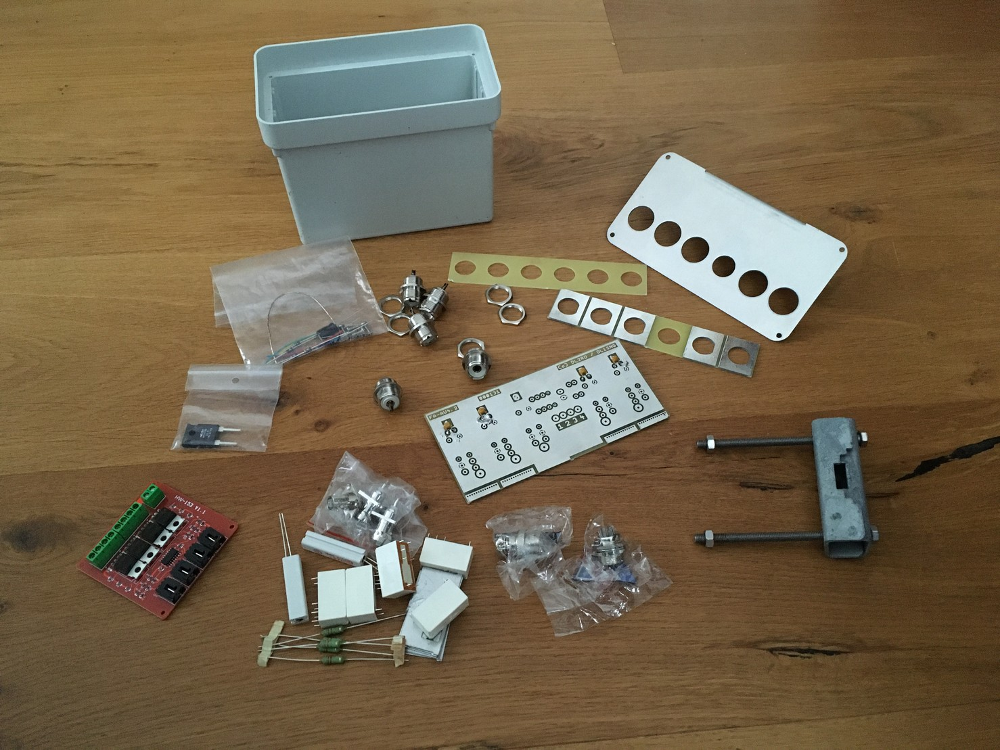
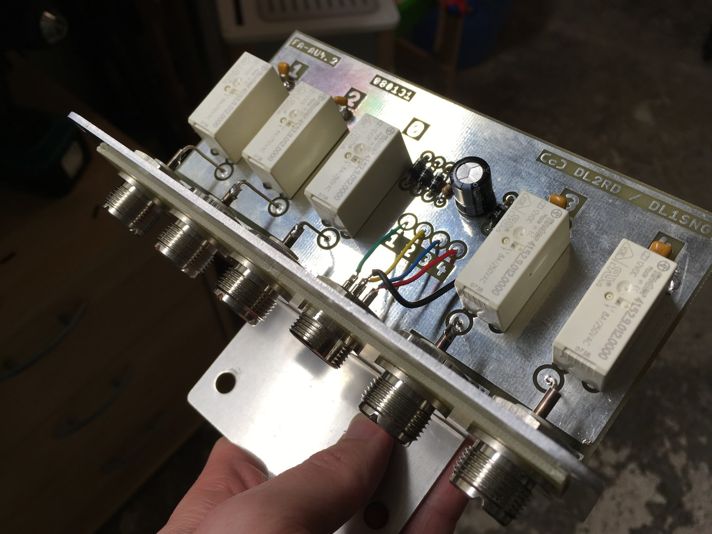

New project: raspberry pi controlled remote antenna switch. One remote rpi for triggering the 4 relais inside the antenna switch and one rpi connected to the TRX in the shack measuring the ATU port’s voltage to fully automatically choose the correct antenna for each band.

Update: The antenna switch itself is assembled and working. Next step: interfacing the pi and coding a simple web service which will be used to select an antenna via network.

