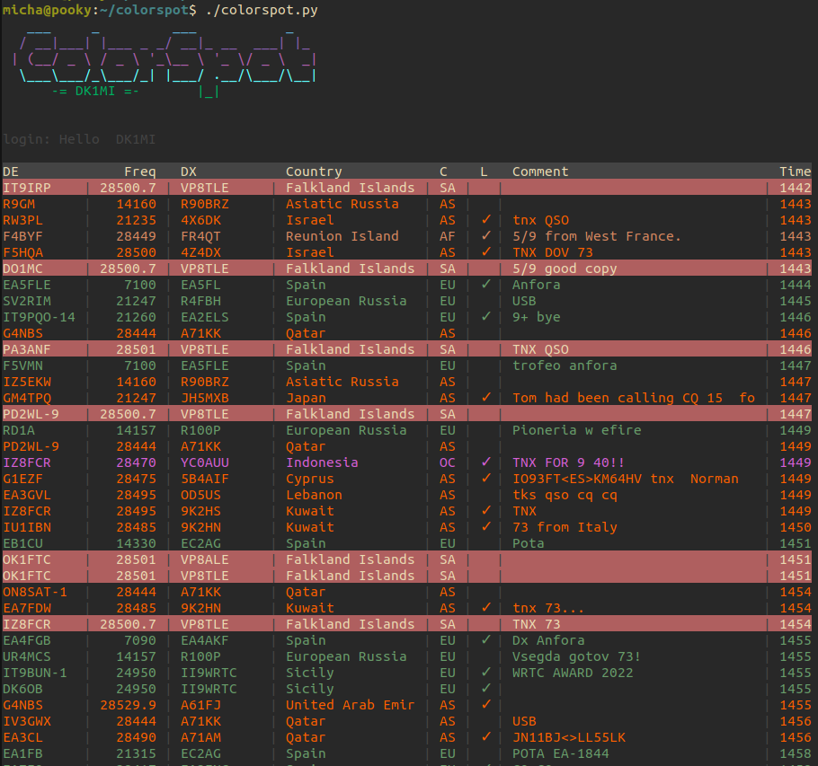

I just released a first version of ColorSpot, a command line DX cluster client written in Python. It adds the following benefits to the default telnet stream:

- displays the DX station’s country
- displays the DX station’s continent
- displays if the DX station uses LotW
- downloads your LotW QSL file and marks all lines with countries that need to be confirmed (optional)
- displays lines in different colors depending on the continent or band (user configurable)

## Code {#code}

You can download the code [here](/files/colorspot.tar.gz).

## Installation {#installation}

It is installable via pip:

```
# python3 -m pip install colorspot

```

## Screenshot {#screenshot}


