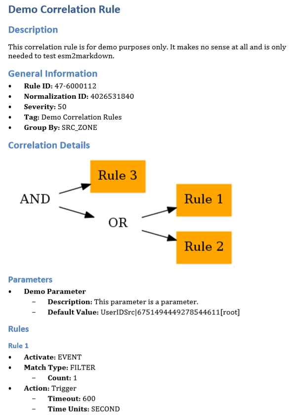

Since we are required to document all custom correlation rules inside our SIEM (McAfee Enterprise Security Manager) for our customers, I wrote a Python script that converts XML rule exports to Markdown. Afterwards its easy to convert teh resulting file e.g. to PDF, DOCX, HTML or even variuous wiki-formats with e.g. Pandoc. This way it’s possible to generate a PDF documentation of all rules with just a few clicks/commands.

On the long shot that this is useful for you, you can find the script here: [esm2markdown.tar.gz](/files/esm2markdown.tar.gz)
