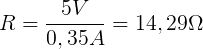
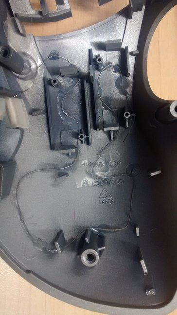
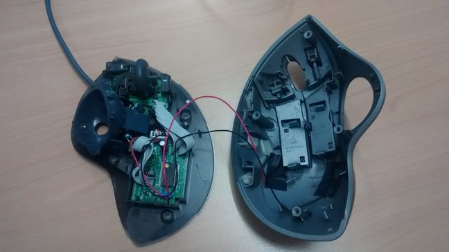
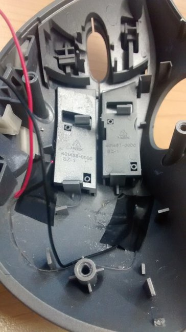
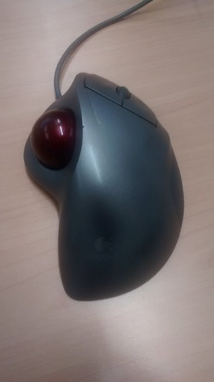

This post describes how to convert a trackball or mouse into a heated input device using simple means. You will need the following parts:

- heating wire (0,2 mm 43,95 Ohm/m Kanthal D)
- some regular wire
- glue
- soldering equipment

Since the USB port should give us 500 mAh and the trackball shouldn’t consume more than 150 mAh, the wire can consume up to 350 mAh. Knowing the voltage of 5 V and the desired power consumption, it is easy to calculate the needed resistor:

The heating wire has a resistance of 43,95 Ohm per meter so the wire needs to be 33 cm long in order to consume 350 mAh.

## Assembly {#assembly}

Glueing the wire to the inner side of the housing:

After reassembling the mouse buttons:

The finished trackball:

