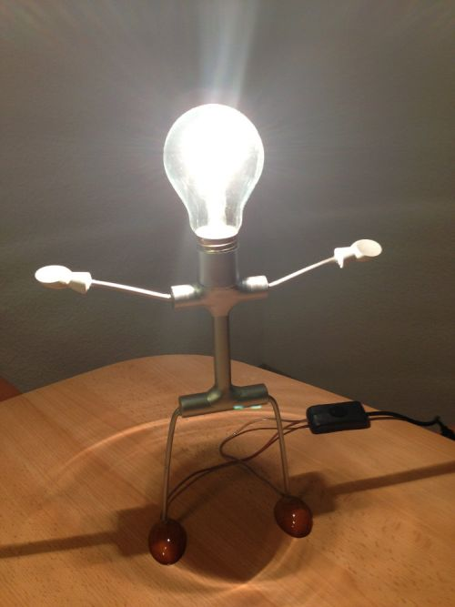

Here’s the result of my attempt to recreate [Gyro Gearloose’s Little Helper (in German: Daniel Düsentrieb’s Helferlein)](https://www.duckipedia.de/Helferlein):

It’s built out of:

- aluminium tubes
- brass sticks
- wooden shoes and gloves
- lots of&nbsp;two-component adhesive
- a 12V 40W bulb with E27 thread
- some wire
- a AC/DC converter 12V 3A
