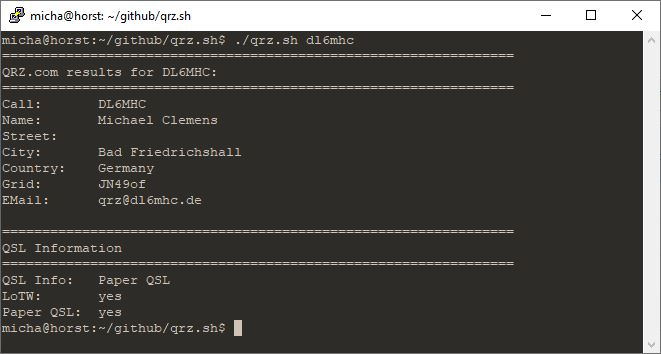

This script queries the QRZ.com callsign database and returns the result to the command line. A XML subscription plan with QRZ.com is required for full functionality.

You can download the script here: [qrz.sh.tar.gz](/files/qrz.sh.tar.gz)



# Installation {#installation}

- Copy the file *.qrz.conf* into your home directory
- Copy the file *qrz.sh* into a directory that is in you PATH variable
- Set the correct file permissions: *chmod u+x qrz.sh*

# Dependencies {#dependencies}

- curl

# Configuration {#configuration}

Edit the file *~/.qrz.conf* like this:

```
user=<your QRZ.com username - typically your callsign>
password=<your QRZ.com password - NOT your API key>
```

# Usage {#usage}

```
# qrz.sh <callsign>
```
