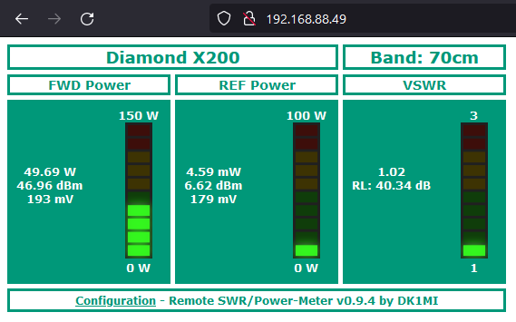
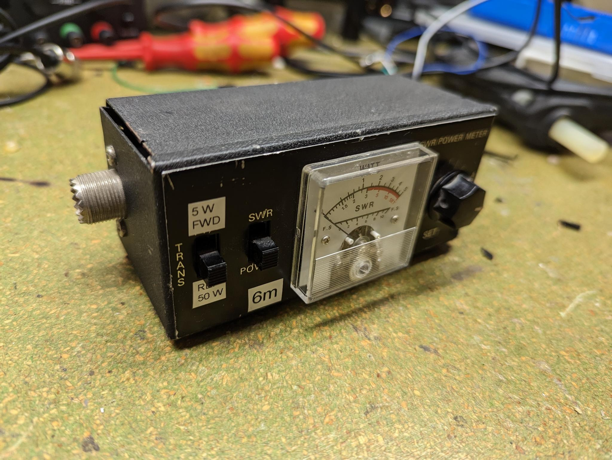
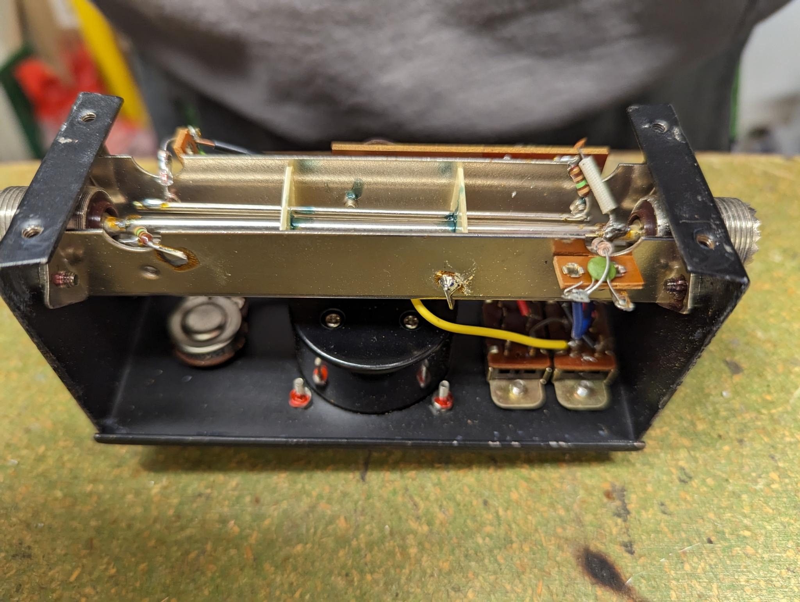
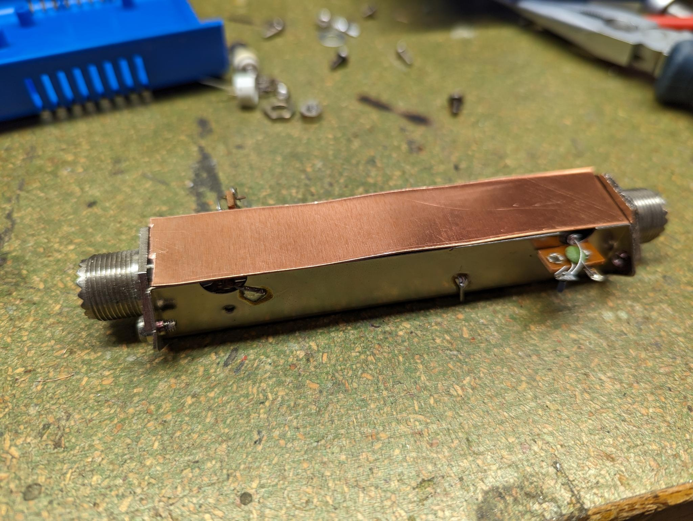
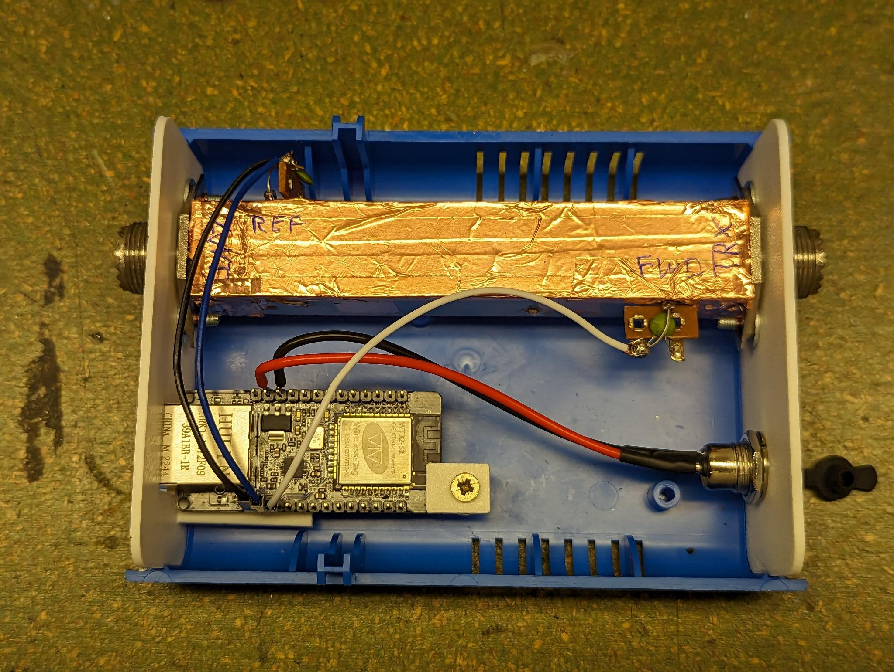
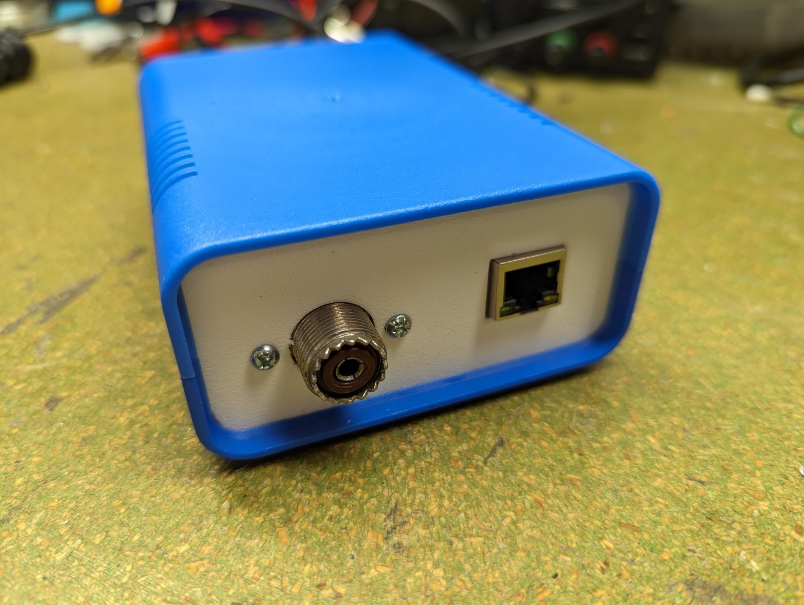
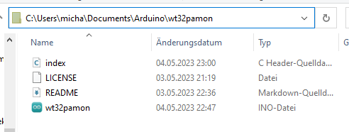
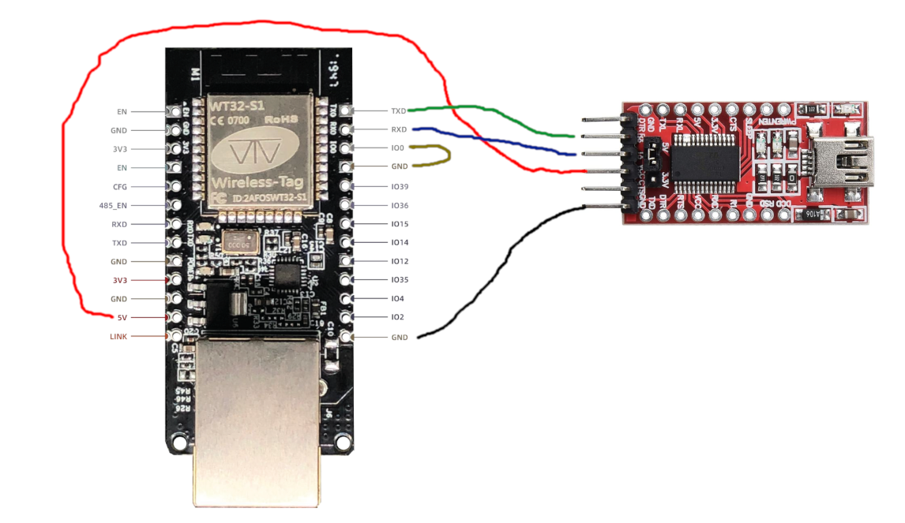
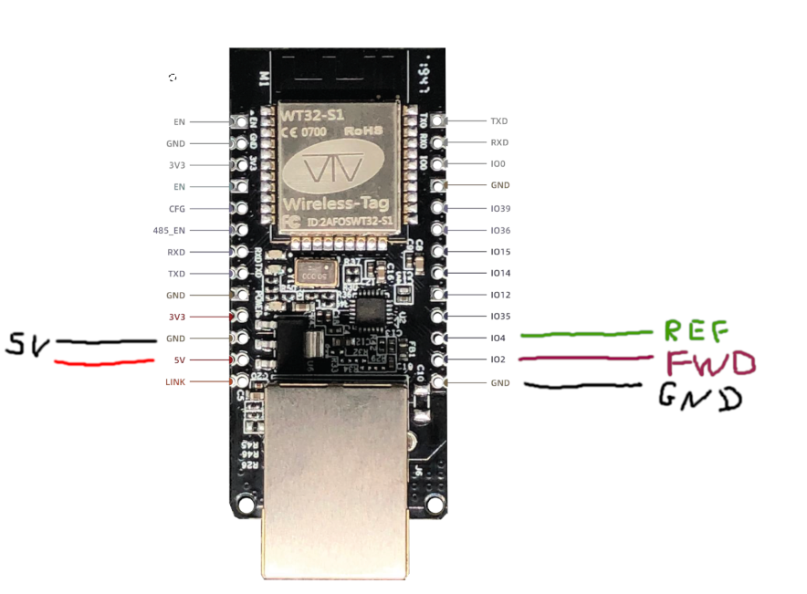
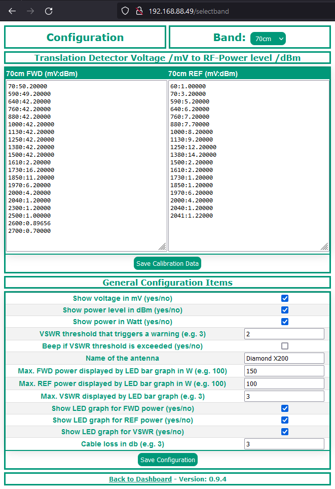

This WT32/ESP32 based project, combined with a directional coupler setup, allows you to remotely monitor the output power and SWR of your station via a web browser.

It reads two voltages which are supplied by the directional couplers. From these, the respective power is calculated with the help of a calibration data table to be created by the user.

Credits for helping me with the directional coupler setup, software testing and feature ideas go to [Matthias DD1US](http://dd1us.de/).



## Preconditions {#preconditions}

### Hardware {#hardware}

The following hardware is needed for this project:

- [wt32-eth01 development board](http://en.wireless-tag.com/product-item-2.html)
- USB to Serial adapter (FTDI)
- directional coupler setup which outputs one voltage (0 to 3.3V) each for the forward and return power. [Matthias DD1US](http://dd1us.de/) uses the following components in his implementations:
  - Ericsson coupler + AD8318 detector
  - Narda coupler + AD8313 detector

My implementation consists of the directional coupler, which i took from an old swr/power meter:





After removing it from the enclose, it needed some shielding:



It fits perfectly into my favorite 5€ project box (Donau Elektronik - KGB15 Euro Box klein, Blau, 95x135x45) with custom 3D printed face plates:



The wiring has been done according the diagram further below.



### Software / Libraries {#software--libraries}

- Arduino IDE
- Project code: [wt32powermeter.tar.gz](/files/wt32powermeter.tar.gz)
- Libraries:
  - WebServer_WT32_ETH01: <https://github.com/khoih-prog/WebServer_WT32_ETH01>
  - DallasTemperature
  - OneWire

## Downloading and Configuring the Arduino IDE {#downloading-and-configuring-the-arduino-ide}

The following steps are needed to be able to compile and upload the code:

- Download and install the Arduino IDE 2.1: <https://wiki-content.arduino.cc/en/software>
- Follow this guide to install the ESP32 board definitions: <https://randomnerdtutorials.com/installing-esp32-arduino-ide-2-0/>
- Select the correct board inside the Arduino IDE: Tools -> Board -> esp32 -> ESP32 Dev Module
- Install all needed libraries:
  - Tools -> Manage Libraries -> Search for “WebServer_WT32_ETH01” -> Install

## Downloading the Software {#downloading-the-software}

- Download the code: [wt32powermeter.tar.gz](/files/wt32powermeter.tar.gz)
- Unzip the code to *c:\users&lt;username>\Documents\Arduino*:



- Open the file *wt32powermeter.ino* inside the Arduino IDE or double-click the file

## Programming the Board {#programming-the-board}

- Connect the board with a USB to serial adapter as shown in the following picture:



- Select the correct COM Port inside the Arduino IDE: Tools -> Port -> Select Port

- Click “Upload” (top left corner, Arrow pointing to the right)

## Connecting the Board to the Directional Coupler {#connecting-the-board-to-the-directional-coupler}



Please note that the two pins *IO0* and *GND* only need to be bridged during programming. Open the bridge again after programming.

## Configuration {#configuration}

Please adapt the following code blocks in the file *wt32powermeter.ino* to your needs:

### Network Configuration {#network-configuration}

```
ETH.begin(ETH_PHY_ADDR, ETH_PHY_POWER);

// Static IP, leave without this line to get IP via DHCP
//ETH.config(myIP, myGW, mySN, myDNS);

WT32_ETH01_waitForConnect();

```

By default, wt32powermeter is configured to dynamically get assigned an IP address via DHCP. If you are happy with this, no actions are needed.
If not, uncomment the line *ETH.config(myIP, myGW, mySN, myDNS);* by removing the two slashes at the beginning of the line to have a static IP configuration assigned.

Please define the desired network configuration in the following code block:

```
// Select the IP address according to your local network
IPAddress myIP(192, 168, 1, 100);
IPAddress myGW(192, 168, 1, 1);
IPAddress mySN(255, 255, 255, 0);
IPAddress myDNS(192, 168, 1, 1);

```

### Selectable Bands {#selectable-bands}

To add or remove bands, find the following code block:

```
String band = "";
String default_band = "70cm";
String band_fwd = band + "_fwd";
String band_ref = band + "_ref";
String band_list[] = { "1.25cm", "3cm", "6cm", "9cm", "13cm", "23cm", "70cm", "2m", "HF" };

```

Add/remove bands from the *band_list\[\]* variable and set your desired default band with *default_band*.

## Accessing the Web Interface {#accessing-the-web-interface}

Open your favorite browser and navigate to *http://YOUR_IP_ADDRESS*, for example *http://192.168.1.100*.

The IP address is either the address you’ve defined above or a dynamically assiged address. To find out the latter, you might want to log in to your router and look for a dashboard that shows all current connected network devices.

## Usage {#usage}

The first step is to configure your connected directonal couplers by clicking “Configuration” in left side of the page footer.



### Calibration Data {#calibration-data}

First, select the band you want to configure via the top right dropdown box labeled “Band”.

Please ignore the actual values of the calibration data. These values have been used for debugging purposes. You need to find your own values for your setup. Enter here the mV:dBm value pairs for FWD and RED and click “Save Calibration Data”.

You can enter your data in any line, there is no need to manually sort the value pairs. After saving the data, it will be automatically sorted and correctly displayed.

Here is how peformed the calibration in my environment:

- Connected the components as folowed: IC-7300 -> Remote Power Meter -> known good power meter -> dummy load
- Set the band to 20m, mode FM
- Set power to 1W, pushed PTT, read the measured power of the known good power meter and the voltage measured by the Remote Power Meter and took notes for the FWD calibration table
- repeated the previous step until I reached max power
- put out the Remote Power Meter, reversed it and put it back into the chain of devices
- Set power to 1W, pushed PTT, read the measured power of the known good power meter and the voltage measured by the Remote Power Meter and took notes for the REF calibration table
- calculated the dBm values for each entry in my notes and replaced every line with <!-- raw HTML omitted -->:<!-- raw HTML omitted -->
- pasted both tables into the Remote Power Meter’s config page

### General Configuration Items {#general-configuration-items}

The following general configuration items are available to customize the application:

- *Show voltage in mV (yes/no)*: Enables or disables the display of the measured voltage
- *Show power level in dBm (yes/no)*: Enables or disables the display of the measured power level in dBm
- *Show power in Watt (yes/no)*: Enables or disables the display of the measured power in Watt
- *VSWR threshold that triggers a warning (e.g. 3)*: any calculated value exceeding the configured value will result in a visual and optionally acoustic warning
- *Beep if VSWR threshold is exceeded (yes/no)*: beeps if the above configured threshold is exceeded. Works only in some browsers.
- \_Name of the antenna: Freely definable name of this band’s antenna
- *Max. FWD power displayed by LED bar graph in W (e.g. 100)*: Sets the upper limit of the LED bar graph for the calculated FWD power
- *Max. REF power displayed by LED bar graph in W (e.g. 100)*: Sets the upper limit of the LED bar graph for the calculated REF power
- *Max. VSWR displayed by LED bar graph (e.g. 3)*: Sets the upper limit of the LED bar graph for the VSWR
- *Show LED graph for FWD power (yes/no)*: enables or disables the VU-meter style LED grapg for the FWD power
- *Show LED graph for REF power (yes/no)*: enables or disables the VU-meter style LED grapg for the REF power
- *Show LED graph for VSWR (yes/no)*: enables or disables the VU-meter style LED grapg for the VSWR
- *Cable loss in db (e.g. 3)*: Sets the cable loss of your system which then will be considered during calculations

After you are done with the desired changes, click “Save Configuration”.

## Warning / Disclaimer {#warning--disclaimer}

This software contains no security mechanisms at all. There is no input/output sanitization/validation in place. Furthermore there is no authentication or authorization mechanism implemented. Any person/system inside the network is able to access the application, read and modify configuration items, gather information about monitored devices.

DO NOT MAKE THE APPLICATION PUBLICLY AVAILABLE! DO NOT EXPOSE THIS TO THE INTERNET.

If you feel uncomfortable using the software as it is, you are more than welcome to contribute, improve, submit PRs etc.
