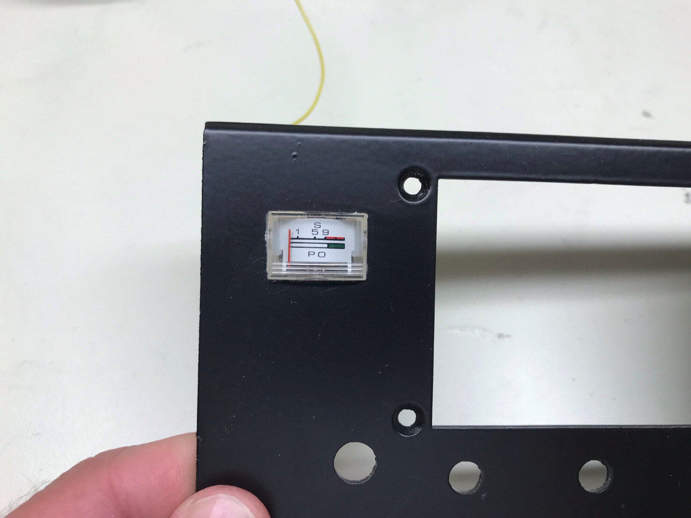
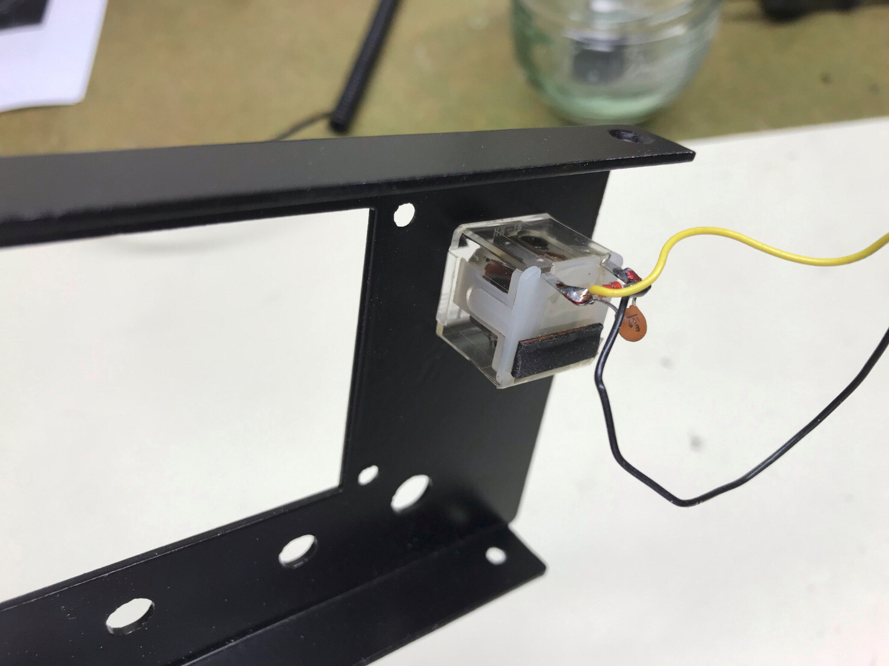
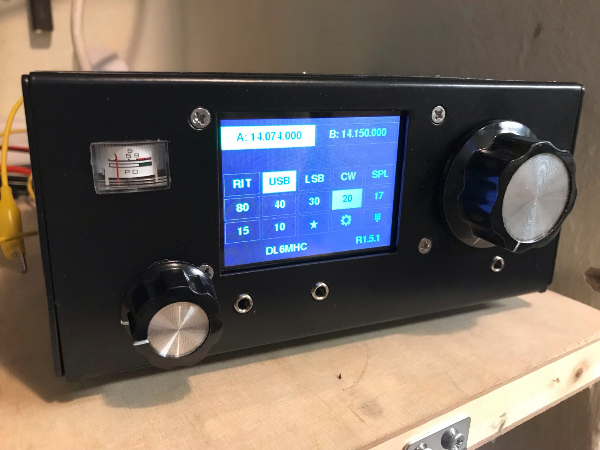

uBitx v6 modifications, Part II: Since the AGC board has a S-Meter tap, the next mod was obvious :) The S-Meter of a dead Yaesu FT-290R was a perfect fit for the uBitx case and I think it looks nice.

